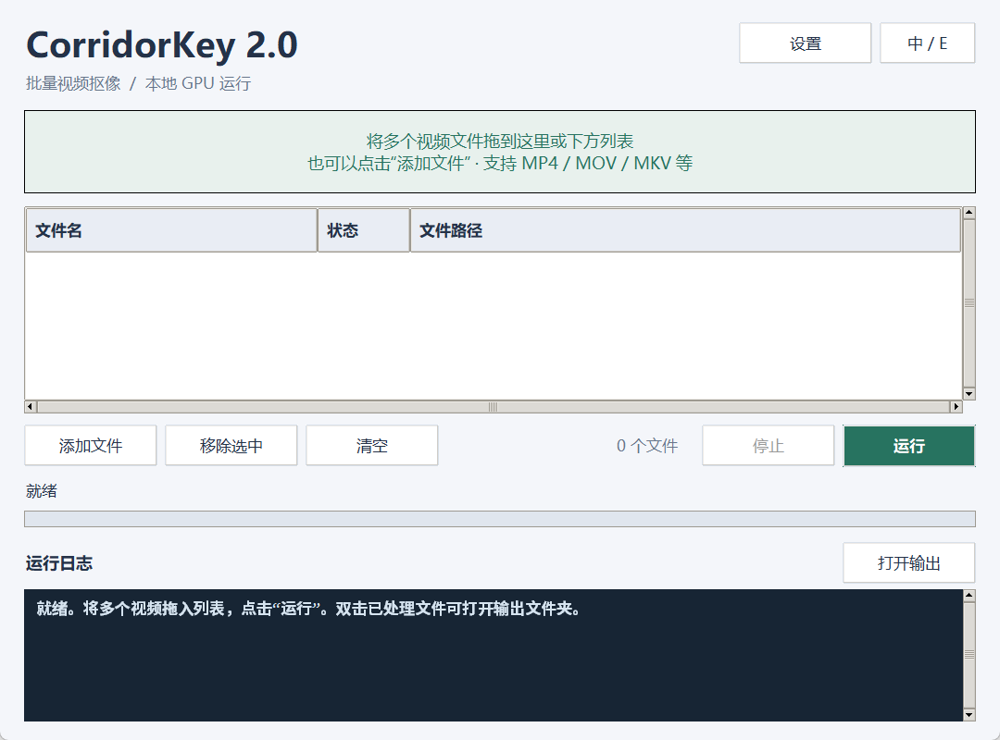

# ck2-gui

**Local Windows batch GUI for [CorridorKey 2.0](https://github.com/nikopueringer/CorridorKey2.0).**

This is an independent, unofficial desktop frontend. It does **not** contain the
CorridorKey model, model weights, or the upstream runtime source. You install
CorridorKey 2.0 separately, then use this GUI to queue clips, configure outputs,
and run inference in the background.

> Not affiliated with or endorsed by Corridor Digital. Not the official
> CorridorKey plugin. See [NOTICE.md](NOTICE.md) and [LICENSE](LICENSE).



---

## 中文

### 这是什么

CorridorKey 2.0 自带的命令行/交互脚本适合单条素材调试，但批量处理时需要反复
输入参数、盯着日志、手动建输出目录。这个项目在它外面加了一层本机桌面界面：

- 拖入多条视频，按顺序批量跑；
- 中文 / English 界面一键切换并记住选择；
- 每个素材单独输出，绝不覆盖已有结果；
- 推理在独立子进程里跑，界面不卡、显存随任务结束释放；
- 可选打包成免安装绿色版（内置 Python、ffmpeg、模型和运行时）。

### 功能

| 功能 | 说明 |
|---|---|
| 批量队列 | 拖入多个视频或文件夹，自动去重；按列表顺序处理 |
| 实时日志 | 每个任务的命令、进度和错误实时显示，同时写入输出目录的 `corridorkey.log` |
| 停止 / 继续 | 可停止当前推理；未开始的文件保留，失败文件不阻塞后续文件 |
| 输出设置 | Alpha、前景 RGB、棋盘格预览、透明 ProRes MOV 任意组合 |
| 显存模式 | 自动按空闲显存选择窗口，或手动低显存模式 + 窗口帧数 |
| 处理缩放 | 1.0 / 0.75 / 0.5，默认保留原生分辨率 |
| 帧数上限 | 0 表示全部；适合快速试片 |
| 自动 hint | 自动查找同名 `<clip>FrameHint.png` 或 `<clip>_AlphaHint.mp4` |
| 输出隔离 | 默认在每个素材旁建 `out_<clip>`；重跑自动加 `_2`、`_3` 后缀 |
| 缓存管理 | 低显存缓存放在输出目录的 `.corridorkey_cache`，任务结束清理 |
| 双语 | 右上角「中 / E」切换，选择保存在设置文件中 |

### 环境要求

- Windows 10/11（主要验证平台；Linux/macOS 理论可运行但未验证）
- 已按上游 README 安装好的 **CorridorKey 2.0**：
  - Python 虚拟环境（本机验证为 Python 3.12 + PyTorch 2.9.1 CUDA 12.8）
  - 模型权重已下载到 `weights/` 和 `vfms/`
  - `ffmpeg` / `ffprobe` 在 `PATH` 中
- 兼容的 NVIDIA GPU 和驱动

本 GUI 只额外依赖 `tkinterdnd2`；Tk 是 Python 标准库的一部分。

### 安装

**方式 A：放进 CorridorKey 2.0 根目录（推荐）**

```
CorridorKey2.0/
  corridorkey/  infer.py  weights/  vfms/  venv/
  ck2-gui/      <- 本仓库
```

```powershell
cd D:\path\to\CorridorKey2.0
git clone https://github.com/leewensong/ck2-gui.git ck2-gui
..\venv\Scripts\python.exe -m pip install -r ck2-gui\requirements-gui.txt
```

然后双击 `ck2-gui\CorridorKey_GUI.bat`，或在 `ck2-gui` 目录运行：

```powershell
..\venv\Scripts\python.exe -m ck2gui
```

**方式 B：放在任意位置**

把本仓库克隆到任意目录，用环境变量指向 CorridorKey 2.0 根目录：

```powershell
$env:CORRIDORKEY_ROOT = "D:\path\to\CorridorKey2.0"
C:\path\to\CorridorKey2.0\venv\Scripts\python.exe -m pip install -r requirements-gui.txt
C:\path\to\CorridorKey2.0\venv\Scripts\python.exe -m ck2gui
```

`CORRIDORKEY_ROOT` 必须指向包含 `infer.py` 和 `corridorkey/` 的目录。

### 使用

1. 双击 `CorridorKey_GUI.bat`（或 `python -m ck2gui`）。
2. 把多个视频拖进窗口列表，或点「添加文件」多选。拖入文件夹时只添加第一层视频。
3. 点「设置」选择输出目录、导出内容、显存模式、缩放和帧数上限，保存后下次自动恢复。
4. 点「运行」。文件状态、进度和日志实时更新；点「停止」终止当前推理。
5. 双击已处理文件，或点「打开输出」，查看结果和 `corridorkey.log`。

提示：

- 已完成的文件不会重复处理；要重跑，请移除后重新添加。
- 停止后可能留下不完整输出，便于检查；不会删除已有结果。
- 模型和 ffmpeg 的原始日志保持英文，不随界面语言翻译。
- 设置保存在本程序目录的 `.corridorkey_gui.json`（绿色版在 `data/`）。

### 输出

| 名称 | 内容 |
|---|---|
| `alpha` | Alpha 遮罩视频 |
| `fg` | 前景 RGB 视频 |
| `checker` | 棋盘格合成预览（含 despill） |
| `cutout` | 带 Alpha 的 ProRes 4444 MOV |

默认输出 Alpha + 前景 + 棋盘格 + 透明视频。命令行 `infer.py` 的默认值不同
（仅 alpha/fg），以 GUI 设置为准。

### 绿色版

`packaging/` 和 `scripts/build_portable.py` 可以把 GUI、Python、ffmpeg、模型
和运行时打成一个免安装目录/ZIP。构建步骤见
[packaging/BUILD.md](packaging/BUILD.md)。绿色版本体不随源码仓库发布。

### 测试

```powershell
cd ck2-gui
..\venv\Scripts\python.exe -m unittest discover -s tests -v
```

测试覆盖设置校验、命令构造、hint 发现、输出目录不覆盖、失败继续、停止子进程、
中英文切换和拖放去重。GUI 测试需要可用的 Tk 显示环境。

### 目录结构

```
ck2-gui/
  ck2gui/
    __init__.py      版本信息
    __main__.py      python -m ck2gui
    app.py           Tk 界面与拖放
    backend.py       设置、命令构造、批处理子进程
    i18n.py          中英文文案
  bootstrap.py       绿色版/源码目录的统一入口
  runtime_check.py   绿色版自检（可选 --smoke）
  CorridorKey_GUI.bat
  requirements-gui.txt
  packaging/         原生启动器源码、图标、构建与绿色版说明
  scripts/           图标生成、绿色版构建/校验/热修复
  tests/             单元测试
  LICENSE            CorridorKey 许可证
  NOTICE.md          非官方说明与来源
  THIRD_PARTY_NOTICES.md
```

### 故障排查

- **「未找到 CorridorKey 2.0 根目录」**：把 `ck2-gui` 放进 CorridorKey 根目录，
  或设置 `CORRIDORKEY_ROOT`。
- **「找不到 ffmpeg」**：把 ffmpeg 加入 `PATH`，绿色版则确认 `bin/` 存在。
- **「缺少模型文件」**：在 CorridorKey 根目录运行
  `python scripts/download_weights.py`。
- **启动报错**：查看程序目录的 `corridorkey_gui_error.log`。
- **8K / 长片低显存**：缓存可能达到数百 GiB；请把输出目录放在空间充足的磁盘，
  并预留安全余量。

---

## English

### What it is

A local batch frontend for CorridorKey 2.0. CorridorKey's own scripts are great
for one clip at a time; this GUI adds:

- a drag-and-drop queue for multiple videos;
- per-file output directories that never overwrite earlier runs;
- live logs, cancellation, and failure isolation between jobs;
- Chinese/English UI with a persisted choice;
- optional portable build with bundled Python, ffmpeg, models, and runtime.

### Requirements

- Windows 10/11 (primary target; Linux/macOS are untested)
- A working CorridorKey 2.0 installation: Python venv with CUDA PyTorch,
  downloaded `weights/` + `vfms/`, and `ffmpeg`/`ffprobe` on `PATH`
- A compatible NVIDIA GPU and driver
- `tkinterdnd2` (the only extra Python package; Tk ships with Python)

### Install

**Option A: inside the CorridorKey 2.0 root (recommended)**

```powershell
cd D:\path\to\CorridorKey2.0
git clone https://github.com/leewensong/ck2-gui.git ck2-gui
..\venv\Scripts\python.exe -m pip install -r ck2-gui\requirements-gui.txt
```

Double-click `ck2-gui\CorridorKey_GUI.bat`, or from the `ck2-gui` folder:

```powershell
..\venv\Scripts\python.exe -m ck2gui
```

**Option B: anywhere**

```powershell
$env:CORRIDORKEY_ROOT = "D:\path\to\CorridorKey2.0"
C:\path\to\CorridorKey2.0\venv\Scripts\python.exe -m pip install -r requirements-gui.txt
C:\path\to\CorridorKey2.0\venv\Scripts\python.exe -m ck2gui
```

`CORRIDORKEY_ROOT` must contain `infer.py` and `corridorkey/`.

### Usage

Drop videos into the list, open **Settings** to choose outputs/VRAM mode/scale,
then click **Run**. The log and per-file status update live. **Stop** terminates
the current inference; already-finished outputs are kept. Double-click a
processed row to open its output folder. Completed files are skipped on the next
run; remove and re-add them to process again.

Outputs: `alpha` matte, `fg` foreground RGB, `checker` preview with despill, and
`cutout` ProRes 4444 with alpha. Each clip gets its own `out_<clip>` folder;
existing folders are never overwritten (`_2`, `_3` suffixes are used).

### Portable build

See [packaging/BUILD.md](packaging/BUILD.md). The built bundle is not published
with this source repository.

### Tests

```powershell
..\venv\Scripts\python.exe -m unittest discover -s tests -v
```

### Notes and limitations

- The GUI never imports the model on the UI thread; inference runs in a child
  process, so closing/cancelling releases GPU memory with the process.
- The GUI is a frontend only. Model quality, color handling, and HDR behavior
  come from CorridorKey 2.0.
- Low-VRAM mode writes feature caches next to the output; long 8K clips can need
  hundreds of GiB of free disk. The upstream runtime checks free space before
  starting.
- Auto-hint discovery only looks for `<clip>FrameHint.png` and
  `<clip>_AlphaHint.mp4` (case-insensitive, no prefix guessing).

### License

This GUI source is distributed under the same terms as CorridorKey 2.0. See
[LICENSE](LICENSE), [NOTICE.md](NOTICE.md), and
[THIRD_PARTY_NOTICES.md](THIRD_PARTY_NOTICES.md).

CorridorKey 2.0 is designed and trained by Zachary Harris in collaboration with
Niko and Corridor Digital. Get the model and the official plugin at
[corridorkey.com](https://corridorkey.com) and
[github.com/nikopueringer/CorridorKey2.0](https://github.com/nikopueringer/CorridorKey2.0).
